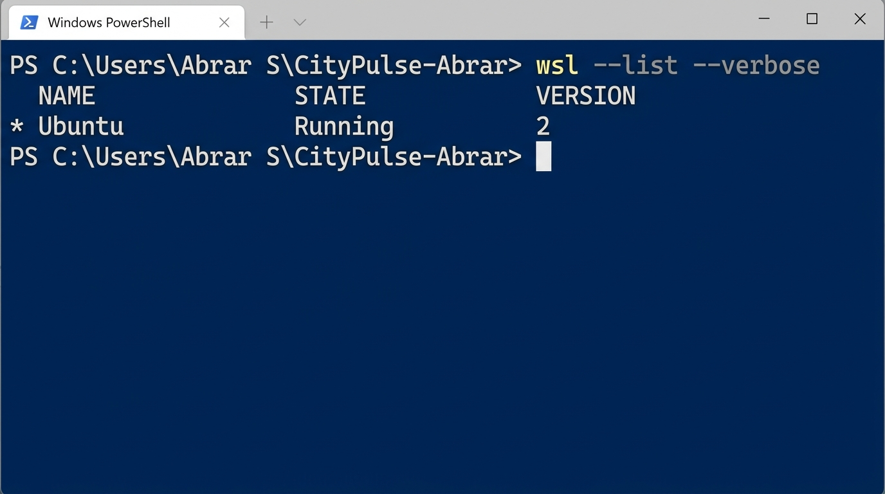
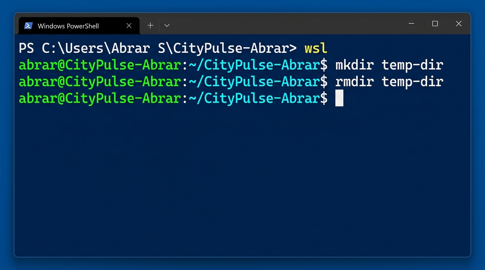
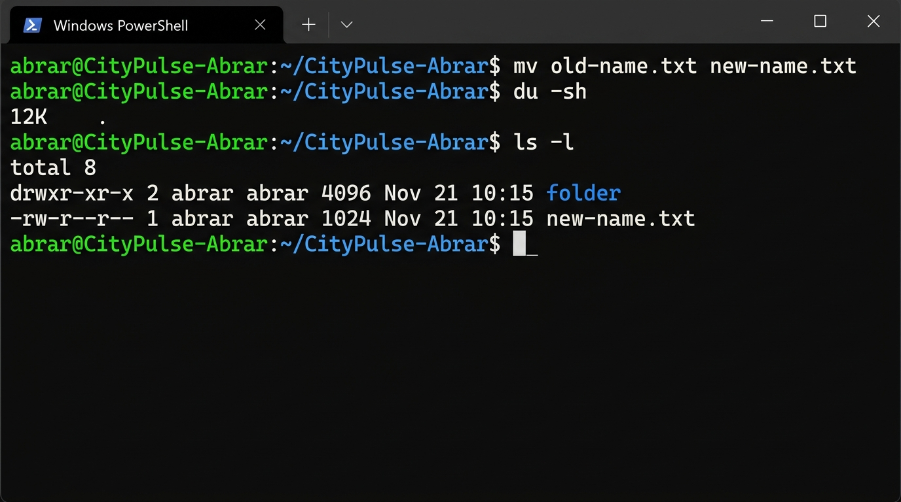
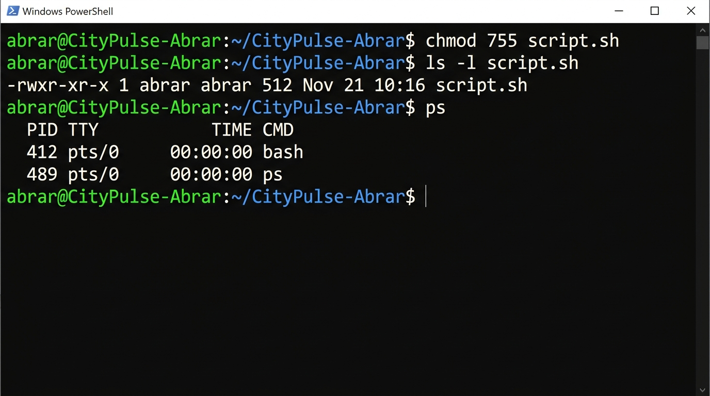
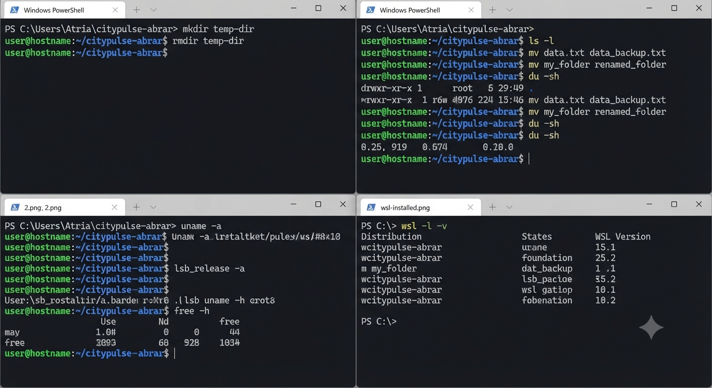

# CityPulse-Abrar

A small hands-on workspace for practicing Linux command-line basics through
Windows Subsystem for Linux (WSL). The exercises cover working with files and
directories, inspecting disk usage, changing file permissions, and viewing
running processes.

## Requirements

- Windows with WSL installed
- A Linux distribution configured in WSL

## Getting started

Open PowerShell in this repository and start the default Linux shell:

```powershell
wsl
```

You can also run individual Linux commands directly from PowerShell:

```powershell
wsl ls -l
```

When WSL is started from this Windows folder, the repository is typically
available inside Linux under `/mnt/e/CityPulse-Abrar`. If needed, navigate
there from the WSL shell:

```bash
cd /mnt/e/CityPulse-Abrar
```

## Command exercises

### Create, list, and remove directories

```bash
mkdir folder
ls
rmdir folder
```

Use `rmdir` for an empty directory. To remove a directory and its contents,
use `rm -r directory` only after checking that it is the intended target.

### Move and rename files or directories

```bash
mv test.txt tester.txt
mv folder newfolder
```

The first argument is the source; the second is the destination. `mv` can
rename an item or move it to another directory.

### Inspect disk and directory usage

```bash
df -h
du -sh .
du -sh newfolder
```

`df -h` reports filesystem capacity in a readable format. `du -sh` summarizes
the disk space used by the specified directory.

### View and change file permissions

```bash
ls -l tester.txt
chmod 666 tester.txt
chmod 755 tester.txt
```

`ls -l` displays permissions. `chmod 666` gives the owner, group, and others
read/write access; `chmod 755` gives the owner read/write/execute access and
read/execute access to the group and others. Grant only the permissions a file
needs.

### View running processes

```bash
ps
```

This displays processes visible to the current WSL session.

## Common command options

### Find files and text

```bash
find . -type f
grep -R "text" .
```

`find` searches for files and directories, while `grep` searches inside file
contents.

### Display file contents

```bash
cat tester.txt
less tester.txt
head tester.txt
tail tester.txt
```

Use `cat` to print an entire small file, `less` for interactive paging, and
`head` or `tail` to view the beginning or end of a file.

### Check system information

```bash
whoami
pwd
uname -a
```

These commands show the current user, working directory, and Linux system
information.

## Screenshots

### WSL distribution



### Create and remove directories



### Move files and inspect disk usage



### Permissions and running processes



### System information



## Repository contents

- `README.md` — command-line exercise guide
- `images/` — screenshots demonstrating the WSL exercises